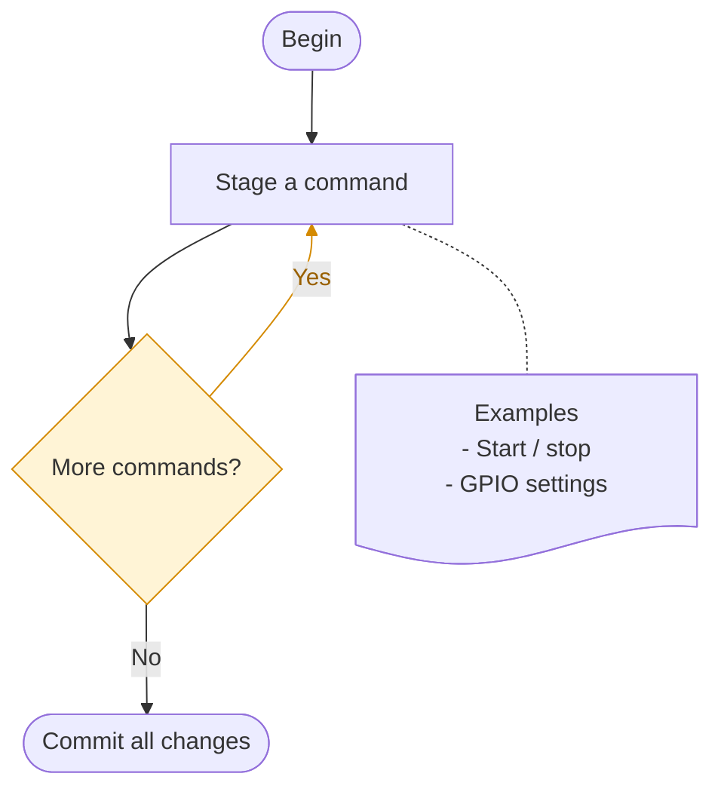

# Blockflow Agent Kit

Blockflow combines **Blockchart** (hardware block diagrams), **Flowchart** (process
diagrams) and **Statechart** (flat FSM diagrams). This offline kit contains seven files. Choose the converter and Schema for the
diagram domain; their JSON formats are separate.

| Domain                     | Converter                | Schema                   | Input                                      | Output    |
| -------------------------- | ------------------------ | ------------------------ | ------------------------------------------ | --------- |
| Hardware / signal diagrams | `blockchart-convert.mjs` | `blockchart.schema.json` | Blockchart JSON                            | JSON, SVG |
| Process / control flow     | `flowchart-convert.mjs`  | `flowchart.schema.json`  | Mermaid Flowchart subset or Flowchart JSON | JSON, SVG |
| Flat state machines        | `statechart-convert.mjs` | `statechart.schema.json` | stateDiagram-v2 subset or Statechart JSON  | JSON, SVG |

All converters contain their own validator, ELK layout and SVG renderer. Requires
**Node.js 22.12+**; no npm install, project source, browser, server or network is needed.
Move this folder to any location. Each converter can run independently; its Schema and
this guide help agents author input. The converters interpret neither screenshots nor
natural language: an agent translates those sources into Mermaid or domain-specific JSON.

- Blockchart build: `blockchart-agent-kit-b7aad4ecc00098e98195`
- Flowchart build: `flowchart-agent-kit-633647beeb3570487332`
- Statechart build: `statechart-agent-kit-ef954fb54538f0a33034`

## Quick start

```sh
node blockchart-convert.mjs hardware.json --check
node blockchart-convert.mjs hardware.json --output hardware.svg

node flowchart-convert.mjs process.mmd --check
node flowchart-convert.mjs process.mmd --output process.json
node flowchart-convert.mjs process.json --output process.svg
node flowchart-convert.mjs process.mmd --output - --format svg
```

Run `node <converter>.mjs --help` for flags and `--version` for its build ID. The Flowchart
text syntax is a documented subset, not the complete Mermaid language. All standalone
tools export JSON and SVG. For PNG, the full project offers SVG-to-PNG exports and the
Flowchart project CLI (`npm run flowchart -- process.json --output process.png --scale 2`).
Native Sharp dependencies are intentionally kept outside these single-file converters.

## Maintainers

In the source checkout, `npm run build:agent-kit` regenerates all converters and Schemas
and this README together. `build:agent-kit:blockchart` remains an alias for this complete
build, so it cannot overwrite the shared guide with an incomplete version. The domain guides below are generated from maintained templates. Each bundle embeds the ELK
license attribution; its full license appears at the end of this README.


## Blockchart Agent Kit

Build: `blockchart-agent-kit-b7aad4ecc00098e98195`

Use this kit to turn a screenshot or a text description into editable Blockchart JSON and
an automatically laid-out SVG. The agent interprets the source and writes JSON; the
converter validates and renders that JSON. It does not recognize images or call an AI.

Blockflow is the project name, covering Blockchart and Flowchart. This section describes
the Blockchart (hardware diagram) converter. The independent Flowchart converter is
documented in its own section below.

To use Blockchart alone, copy these three files:

- `blockchart.schema.json`: JSON Schema Draft 2020-12 for authoring documents.
- `README.md`: field semantics, authoring workflow and executable examples.
- `blockchart-convert.mjs`: standalone Node.js CLI and importable API, including the
  authoritative model validator, ELK layout and SVG renderer.

Requires **Node.js 22.12 or later**. No package installation, project source, browser,
network, server or editor is needed. Move these three files together to any directory.
Only JSON and SVG output are supported. PNG is not included.

### Recommended agent workflow

1. Identify real blocks, external interfaces, ports and connections. Assign stable IDs.
2. Choose horizontal or vertical flow. Reproduce connectivity and intent first; ELK owns
   placement. Exact screenshot coordinates and pixel matching are not supported.
3. Write a raw version 1 authoring document using the schema and rules below. Do not write
   normalized models, layout records, localStorage wrappers, HTML or SVG as input.
4. Run `--check`, fix the reported semantic error, and repeat until valid.
5. Export SVG. Inspect the image and any label-placement warnings, then adjust names,
   grouping, relative sizes, styles or spacing and render again.
6. Deliver the JSON and/or SVG. The JSON remains editable authoring data.

Open or edit the JSON in blockflow Studio. For GUI usage, see the
[Studio editing guide](https://github.com/rexrainbow/blockflow/blob/main/docs/studio.md).
This kit documents the JSON contract and converter APIs; the optional GUI guide is
external to the standalone kit.

Schema validation alone cannot check references, driver conflicts, hierarchy, boundary
crossings or Concat sums. The converter's model validator is authoritative. It does not
silently migrate obsolete fields, repair broken links or insert defaults into saved JSON.

### CLI

```powershell
node blockchart-convert.mjs diagram.json --check
node blockchart-convert.mjs diagram.json --output diagram.svg
node blockchart-convert.mjs diagram.json --output formatted.json
node blockchart-convert.mjs diagram.json --output group.svg --view Processing
node blockchart-convert.mjs diagram.json --output diagram.svg --diagnostics json
node blockchart-convert.mjs --version
node blockchart-convert.mjs --help
```

Quote paths containing spaces. Any working directory is supported; input/output paths
resolve relative to that working directory. `--view` is SVG-only and selects an existing
group ID; omit it to draw the entire diagram. The whole graph is validated before scoping.
SVG shows that group's frame, real interface ports and subtree, excluding external edges.
The selected root is expanded; descendants keep their collapsed settings.

Use input `-` to read UTF-8 JSON from stdin. A UTF-8 BOM is accepted. Use `--output -` with
`--format json` or `--format svg` to send data to stdout. Otherwise the output filename
must end in `.json` or `.svg`; an explicit `--format` must match its extension.

`--check` only validates; it does not perform layout or create files. JSON export validates
and pretty-prints the original full document, preserving port order, optional omissions,
labels and styles. It never saves inferred widths, layout coordinates or virtual ports.
SVG export uses the same model/layout/renderer as the editor. Export creates parent output
directories and replaces an existing output file, but refuses to overwrite the input JSON,
including path aliases. Validation/layout failures leave existing output files untouched.

**All diagnostics go to stderr.** Only explicit stdout export, help and version use stdout.
`--diagnostics json` emits one JSON diagnostic object with `ok`, `stage`, optional `path`,
`message` on failure, `warnings` on success, and `kitVersion`. This keeps data pipelines clean.
Stages include `arguments`, `read`, `JSON`, `validation`, `layout`, `SVG`, `write` and `export`.
Exit codes: **0** success, **1** input/validation/layout/I/O failure, **2** argument error.
Label-placement warnings such as `EDGE_LABEL_OVERLAP` keep a usable SVG and exit 0; inspect
the image and shorten labels or increase spacing. A check-only success does not guarantee
that a later layout has no warnings.

### Minimal complete document

Save this as `diagram.json`, then run the first two commands above:

```json
{
  "version": 1,
  "diagram": {
    "name": "Source to Sink"
  },
  "modules": [
    {
      "id": "Source",
      "ports": [
        {
          "id": "out",
          "direction": "output"
        }
      ]
    },
    {
      "id": "Sink",
      "ports": [
        {
          "id": "in",
          "direction": "input"
        }
      ]
    }
  ],
  "connections": [
    {
      "from": "Source.out",
      "to": ["Sink.in"],
      "label": "Data"
    }
  ],
  "layout": {
    "direction": "right"
  }
}
```

### Identity, names and connectivity

- Required root fields: `version: 1`, `diagram` with non-blank `name`, and `modules`.
  Optional: `connections`, `groups`, `terminals`, `layout`. Unknown properties are rejected;
  do not add `$schema` inside a diagram. Configure schema association outside the document.
- At least one module or group is required. `modules: []` is valid for group-only diagrams.
  Ordinary modules may omit ports or use an empty array. Concat still requires input/output ports. Unconnected ports and empty groups are allowed.
- IDs match `[A-Za-z_][A-Za-z0-9_]*`. Block, group and terminal IDs share one unique namespace;
  port IDs are unique within their owner across input/output directions.
- Optional `label` is display text; omit it to use the ID for blocks, groups, ports and
  terminals. Omit a connection label for no text. Explicit blank strings and null are invalid.
  Display text supports Unicode and LF line breaks; CRLF becomes LF. IDs and `diagram.name`
  are single-line; tabs, bare CR and unsupported XML/control characters are invalid.
  The diagram name is metadata, not a rendered heading. Renaming an ID requires updating
  every affected endpoint and group membership reference.
- Normal endpoints are strings such as `Source.out`. `from` must send and `to` must receive.
  One output may fan out; an input has one driver. Duplicate edges are invalid. Self-loops
  and multi-block cycles are allowed. Crossing different Nets never connects them.
  Actual same-Net forks automatically receive solid junction dots when clear of
  Ports, labels, hardware and other Nets. No manual junction objects or fields are needed.
- Port `width` is an optional positive safe integer **bit count**. Omit it for unknown;
  never write null. Only two explicitly known endpoint widths must match. One known end
  determines that connection's width, without inferring any other port or branch width.
  Bus notation is appended to port/terminal names when width is greater than one.
- Module/group `width` and `height` are optional positive finite **relative minimum sizes**
  in fixed 140-by-84 units. They are unrelated to port bit width. Omit for Auto; content may
  enlarge the shape. Text and strokes are not scaled. Extra size does not force straight wires.

### Flow, appearance and labels

Use `layout.direction: "right"` for Left to right or `"down"` for Top to bottom.
Only `right` and `down` flow are accepted.
Input/output ports use left/right for horizontal flow and top/bottom for Down. Port array
order is top-to-bottom horizontally and left-to-right in Down. Text remains horizontal.
Relative width/height stay screen dimensions. Module and connection array order does not
guarantee placement. Do not invent coordinates, edge IDs, ranks, `alignmentGroups`,
`layout.orderMode`, edge order or alignment fields.

Optional module `appearance` is an object with one of these exact profiles:

| Type        | Parameters                             | Meaning                                                          |
| ----------- | -------------------------------------- | ---------------------------------------------------------------- |
| `rectangle` | `type` only                            | Default ordinary block                                           |
| `bar`       | `type` only                            | Compact bar; default for Concat; horizontal in Down              |
| `stacked`   | `layers`: integer 1–3, default 2       | Visual backing plates only; no members or expansion              |
| `trapezoid` | `rightHeightRatio`: 0.2–1, default 0.6 | Shorter centered output side; right horizontally, bottom in Down |

Appearance controls title, port placement and the full occupied bounds. Routing avoids a
conservative rectangular footprint. Groups do not accept module `appearance`; their
collapsed behavior is controlled by group type. Concat only permits Bar (or omitted appearance); ordinary Block appearances do not change connectivity.

### Concat: optional widths and ordered composition

Use module `type: "concat"` for multiple ordered input ports and exactly one output.
Ordinary modules omit `type` or use `"block"`. First input is the high part for bit-level
concatenation, independently of where source blocks are placed. Do not simulate this by
giving one input multiple drivers. Each input keeps its own endpoint.

Concat always uses a thin Flow-aligned Bar. Down: inputs top, output bottom, horizontal
bar. Right (also the default): inputs left, output right, vertical bar. Omit Port `side`
to follow Flow; an explicit conflicting side is rejected, including on feedback inputs.
Concat only accepts omitted `appearance` or `{ "type": "bar" }`. Ordinary Block Bar
appearance retains its general-purpose behavior and side choices.

Input order determines anchor order; the output is centered between the outer inputs.
The filled body thickness is 12 logical units plus border-width allowance, independent
of label sizes. Names, visible Port text and receiving Net labels reserve external
layout space or lengthen the bar. Width/height minima apply to the layout envelope;
they do not thicken its body. JSON retains only authoring values, never these calculated
positions or label reservations.
Physical input/output anchors and arrow tips stay on the bar edges, including with
multiline titles, visible Port names and explicit size minimums. The engine restores
bar anchors after ELK and repairs affected routes in Auto, Grid and scoped views.
The reserved text envelope remains available for placement and obstacle avoidance.

- No widths: abstract composition, no sum check.
- Partial widths: preserve annotations; skip the sum check.
- Every input and the output explicitly sized: output must equal the input sum.

Widths are never inferred or propagated. Existing per-connection width checks still apply.
There are no automatic bit-range labels. This standalone example is abstract; adding widths
16, 16 and 32 to its three ports enables the sum check:

```json
{
  "version": 1,
  "diagram": {
    "name": "Abstract composition"
  },
  "modules": [
    {
      "id": "Combine",
      "type": "concat",
      "label": "Concat",
      "style": {
        "label": {
          "hidden": true
        },
        "portLabel": {
          "hidden": true
        }
      },
      "ports": [
        {
          "id": "first",
          "direction": "input"
        },
        {
          "id": "second",
          "direction": "input"
        },
        {
          "id": "out",
          "direction": "output"
        }
      ]
    }
  ],
  "layout": {
    "direction": "down"
  }
}
```

### External terminals

Root `terminals` are named external interfaces without real blocks. Each requires `id`
and `direction` (`input` supplies the graph, `output` receives from it); optional fields are
multiline `label`, bit `width` and direct text `style`. Use an endpoint object containing
**only** `terminal`, such as `{ "terminal": "ExternalInput" }`. Do not use a bare terminal
ID or an `@terminal:` string. The other end must be a real block/Boundary port. An external
input may fan out; an external output has one incoming driver. Terminals are root items,
cannot be group members or bypass boundaries, and do not replace the required block/group.
They appear left/right or top/bottom for the selected flow.

Same-side Terminal anchors align by default: a common X for each input/output side in
horizontal flow, or a common Y for each side in Down flow. Terminal text and associated
virtual signal labels move together. Their complete envelopes stay outside the internal
Block/Group layout; overlapping same-side envelopes are separated along the side before
affected connections are rerouted. Reduce bends then moves Terminals only along that side,
preserving alignment. No authoring setting or coordinates are required.

```json
{
  "version": 1,
  "diagram": {
    "name": "External interfaces"
  },
  "terminals": [
    {
      "id": "ExternalInput",
      "label": "Input",
      "direction": "input"
    },
    {
      "id": "ExternalOutput",
      "label": "Output",
      "direction": "output"
    }
  ],
  "modules": [
    {
      "id": "Logic",
      "ports": [
        {
          "id": "in",
          "direction": "input"
        },
        {
          "id": "out",
          "direction": "output"
        }
      ]
    }
  ],
  "connections": [
    {
      "from": {
        "terminal": "ExternalInput"
      },
      "to": ["Logic.in"]
    },
    {
      "from": "Logic.out",
      "to": [
        {
          "terminal": "ExternalOutput"
        }
      ]
    }
  ]
}
```

### Groups and real boundaries

Keep modules and connections flat. Root `groups` entries require `id` and `members`
(module or group IDs); optional fields include `label`, `type`, `style`, `width`, `height`,
`ports` and `collapsed`. An object has at most one parent. No duplicate
members, unknown members, self/indirect cycles or terminal members. Unlisted items stay root.

| Group type            | Connectivity                                                             | Collapse                                                |
| --------------------- | ------------------------------------------------------------------------ | ------------------------------------------------------- |
| `container` (default) | Direct child connections; stored group ports inactive                    | Cannot collapse                                         |
| `boundary`            | Real interface ports; every boundary must be crossed one level at a time | Same ports on the collapsed face                        |
| `collection`          | Direct when expanded                                                     | Visual stack and member count; virtual crossing anchors |

For a Boundary, outside input receives and outside output sends; inside input sends to
children and inside output receives from children. Use explicit edges at every level:
`Source.out -> Outer.in -> Inner.in -> Child.in`, then
`Child.out -> Inner.out -> Outer.out -> Sink.in`. Each endpoint face has a single incoming
driver and may fan out. Input-to-output inside pass-through and output-to-input outside
feedback are distinct valid connections. Width checks remain per connection.

Set `collapsed: true` on Boundary/Collection to hide contents while preserving all members,
definitions and original edges. Full validation still runs for hidden data. Container
rejects true. Ancestor collapse wins. Collection uses virtual Input/Output anchors only
in layout; never author them in JSON or rewrite original endpoints. Crossing edges retain
separate identities and styles, even when visually coincident. Grouping does not impose
same-rank alignment or fixed positions. The old `portMode` field is rejected.

### Portable styles and hiding text

Defaults are `diagram.style.module` and `diagram.style.connection`. Local module, group,
port, terminal and connection `style` objects override supported fields per property.
Use exact keys from the schema, never CSS, HTML, URLs, font-family strings or scripts.

- Module/group border/fill: `borderColor`, `borderWidth`, `borderStyle`, `borderOpacity`,
  `fillColor`, `fillOpacity`; text subgroups: `label`, `portLabel`, `inputPortLabel`,
  `outputPortLabel`.
- Connection: `strokeColor`, `strokeWidth`, `lineStyle`, `opacity`, `startArrow` / `endArrow` (`none` default
  or `triangle` at the destination), and `label` text style. Arrows follow the final route
  and share line color/opacity. Bit width does not force a user-specified stroke width.
- Text: `color`, `fontSize`, `backgroundColor`, `padding`, `opacity`, `backgroundOpacity`,
  `hidden`. Terminal and individual Port styles are text styles directly.
- Colors: hex `#RGB`, `#RGBA`, `#RRGGBB`, `#RRGGBBAA` or `transparent`. No CSS color names or
  functions. Patterns: `solid`, `dashed`, `dotted`. Font/border/stroke sizes must be positive
  finite numbers; padding is non-negative. All opacity values are in [0, 1].
- Port text precedence: diagram common, diagram direction, owner common, owner direction,
  individual Port. Group border/title defaults are independent of module border/title
  defaults; shared diagram Port text defaults also apply to group interfaces.

Every text style supports boolean `hidden`, default false. Terminal/Port use `style.hidden`;
Block/Group/Connection names use `style.label.hidden`; shared Port names use
`style.portLabel.hidden` or direction-specific text styles. Explicit false overrides
inherited true. Hidden text, backgrounds and bus notation reserve no text space; preserve
the original name and owning object, anchors and connections. Omission still uses ID fallback
where supported. Empty labels remain invalid. `showPortLabels` is not supported.

Source and receiver Inline labels reserve virtual nodes beside their Ports, controlled by `repeatAtEnd` and `longThreshold`.
Never author `xlabel`, manual label coordinates or rotations.
SVG uses monospace text with conservative width estimates; actual font appearance depends
on the viewer. Inspect the rendered result when long or non-Latin names are important.

### Nets and virtual signal labels

For new authoring, prefer array-target Connections such as
`{"id":"data","from":"ALU.result","to":["Register.data","Comparator.data"],"label":"Result"}`.
Each target may instead be an object with `endpoint`, optional `constraint`, `feedback` and
line-only `style`; label styles and `startArrow` belong to the whole Net. A source has one Net. Targets cannot
repeat, equal the main endpoint or conflict with another driver. All known shared widths
must agree. Unknown widths remain valid. Boundary-port face rules are unchanged.

Set `direction: "both"` for one main/reference endpoint plus N abstract bidirectional peers;
all Ports must be `inout`. The main endpoint may participate in every branch of the same Net.
Unrelated Nets cannot claim occupied faces. This describes connectivity without arbitration,
responder selection, electrical or timing simulation. Arrow style overrides remain cosmetic.
Concat remains a real element joining separate input Nets into its output Net.

A labeled Net reserves one small source-adjacent virtual signal node, with measured text and
an 8-unit local gap. Its source footprint participates in hierarchical Auto/Grid placement.
Virtual nodes/groups never enter saved JSON or exported hardware. A common Inline name stays
near the source. Receiver names are also Inline nodes, adjacent to their receiving Ports:
`style.label.repeatAtEnd` is `auto` (default), `always` or `never`; positive `longThreshold`
defaults to 600 logical units. Always includes receiver footprints in the first layout; Never
omits them. Auto tests first-pass routed source-to-target length, freezes the selected
branches and runs one more layout with their receiver nodes. At most two passes are used;
second-pass lengths do not alter the selection. Receiver nodes follow Port sides and order.
Multi-Port targets, including Concat, may grow across the flow to fit names. Terminal receiver
names are packed locally too. Placement may change; explicit dimensions remain minima.
The short tail still ends at the physical Port. Hidden removes every virtual footprint and
label. Conflicts still produce warnings. Scalar targets and retired fields are rejected
without automatic migration.

### Layout and exterior feedback

All connections participate together in one layout, not staged batches. The accepted
layout options are:

| Field                 | Values / default                                               |
| --------------------- | -------------------------------------------------------------- |
| `direction`           | `right` default, `down`                                        |
| `routing`             | `orthogonal` only                                              |
| `placement`           | `default` default, `relaxed`, `simple`                         |
| `moduleSpacing`       | Positive finite number, default 20                             |
| `layerSpacing`        | Positive finite number, default 30                             |
| `portAdjustment`      | `reduce-bends` default, or `fixed`                             |
| `maxPortShift`        | Finite non-negative logical SVG distance, default 40           |
| `feedbackRouting`     | `elk` default or `outer`                                       |
| `feedbackSide`        | `auto` default; horizontal `top`/`bottom`, Down `left`/`right` |
| `feedbackMargin`      | Positive finite number, default 20                             |
| `feedbackLaneSpacing` | Positive finite number, default 12                             |

An incompatible side is invalid even when Outer is disabled. When changing JSON flow axes,
map Top ↔ Left and Bottom ↔ Right yourself; the converter does not rewrite settings.
`outer` supports Right and Down. It attempts routes outside the visible
bounding rectangles. A blocked requested side keeps the ELK route without switching sides.
Terminal edges, boundary-scoped edges and group views retain their ELK routing fallbacks.
Endpoint access may pass through an ordinary Container heading in Right or Down flow.
Real hardware and reserved signal labels still block access; Boundary headings and
collapsed frames keep their existing protection. A genuinely blocked side falls back.

Connection `feedback: true` lowers its direction priority during cycle breaking. It does
not itself enable Outer, force backward routing, align blocks or remove ranking constraints.
Omit it or use false for normal priority. Unused ports, cycles, long labels and groups can
change the arrangement; reproduce intent instead of promising exact screenshot geometry.

### Port adjustment

Fixed orthogonal routing scores the complete path, including turns between endpoint
escape segments and the searched middle path. Equal-length clear candidates therefore
prefer fewer total bends. Departure/arrival directions stay fixed, immediate reversals
over escape segments are rejected, and obstacle/scope constraints remain intact. This
changes wire selection without moving Blocks or Ports and adds no authoring option.

By default, `layout.portAdjustment: "reduce-bends"` enables a bounded post-placement pass that may slide
rectangular/stacked Block Ports along their existing side. It preserves Block positions and
sizes, Port order, at least 16-unit anchor spacing and label/title clearance. Names move with
anchors; source signal nodes move only within their reserved wrapper. Concat, other shapes,
Group Ports and feedback anchors remain fixed. Terminal anchors and names move together
perpendicular to flow with the same shift limit; order and separation are preserved, and
moves overlapping Blocks, Groups or other Terminals are rejected. Terminal adjustment also rejects changes that increase
connection-label clearance warnings. `maxPortShift` limits movement
from the initial anchor (default 40); zero or `portAdjustment: "fixed"` disables it. All affected Net branches are checked together.
Obstacle-hit and foreign-Net crossing counts cannot increase; accepted changes improve
bends, displacement, then length. Search is deterministic and bounded to four passes/128
trials, with no global optimum guarantee. Reserved Inline names follow their Ports; final arrows follow this pass. Auto/Grid,
group views and the editor share this pipeline. JSON export preserves configuration only.

Reduce-bends prioritizes fewer bends, then less total displacement from initial
Port/Terminal anchors, then shorter routed length. It does not move an initially
fixed anchor solely to shorten a route with the same bend count. Real bend reduction
can still justify movement within the existing bounds and safety constraints.

Reduce-bends first tries aligning at the current Port position of the less-populated
face when both endpoints can move. This keeps a centered single-Port interface stable
when the multi-Port peer can make the alignment. Sparse faces remain movable if that
choice is blocked or out of range; existing bounds/safety/quality checks still apply.

### Importable JavaScript API

Importing the converter performs no CLI work:

```javascript
import { validateDiagram, convertDiagram, KIT_VERSION } from './blockchart-convert.mjs';
validateDiagram(document); // { ok: true }, or throws with stage/path
const svg = await convertDiagram(document, { format: 'svg' });
// svg.text is SVG; svg.warnings contains layout warnings.
const json = await convertDiagram(document, { format: 'json' });
const scoped = await convertDiagram(document, { format: 'svg', rootGroupId: 'Processing' });
```

The default format is SVG. Input objects are not mutated. JSON always saves the full raw
document; `rootGroupId` is SVG-only. These functions return strings and do not write files.
Use `KIT_VERSION` or CLI `--version` to identify this matched build of schema, guide and code.

### Bundle provenance

The converter bundles the project's model/layout/SVG code and elkjs 0.12.1.
ELK source and notices: https://github.com/kieler/elkjs . Its license is reproduced below.
No Sharp or PNG renderer is bundled. The separate schema is for agent/editor tooling;
conversion uses the bundled authoritative validator and does not fetch external schemas.

Project maintainers regenerate all three artifacts with `npm run build:agent-kit` in the
source checkout. Kit consumers never need that checkout or the build toolchain.

### Grid and overview diagrams

Groups can override `layout.moduleSpacing` and `layout.layerSpacing` with finite
positive numbers. Each omitted property inherits the nearest ancestor override, then
root/default. Null/zero are invalid. These are interior Auto spacing budgets; the
parent controls the group's external spacing. Grid row/column gaps stay independent,
but Auto neighbors of a partial Grid use local spacing. Collapsed groups retain
inactive settings, and group views retain inherited values. Saved JSON preserves
omissions rather than copying effective defaults onto every group. For example,
`"layout": { "layerSpacing": 60 }` keeps Auto mode and inherits module spacing.

Grid gaps are minima: Down reserves horizontal routing tracks between source rows;
Right reserves vertical tracks between source columns. Only crowded gaps expand.
One Net shares its fan-out track, disjoint spans may reuse a track and different Nets
reserve separate ink space. Physical/synthetic labels and scoped obstacle rules still
apply. Blocked access keeps the previous path; perpendicular crossings can remain.
This is automatic runtime behavior with no additional authoring fields. Eligible
ordinary Auto Containers also reserve tracks between adjacent geometric flow bands.
Only congested forward facing-Port links within one Container participate. Local or
inherited layerSpacing provides the initial budget; only missing space is added.
Transverse positions/order stay fixed while later layers and enclosing frames may
move/grow. Root/cross-Container traffic, skipped layers, feedback, bidirectional and
side-facing links keep general routing. Grid-controlled and Boundary/Collection
subtrees retain their existing behavior. Safe-access failure retains a general route;
arbitrary diagrams are not promised to be crossing/overlap-free.

Use `layout.type: "grid"` and rectangular `layout.cells` at the root, or put the same
configuration in a group's `layout`. Omission or `type: "auto"` keeps automatic placement.
Each non-null cell is a direct member ID, used at most once; null reserves an empty slot.
Choose any subset; unlisted direct members remain automatic. Root members exclude items already
in a group and exclude Terminals. Rows run top to bottom and columns left to right,
independently of Flow. Cells share measured row heights/column widths and center their
contents. Optional non-negative `rowGap` / `columnGap` default to 50 / 80. Empty tracks use
140-by-84 logical minimum space. Container nesting can express layout-only columns: hide
its title, border and fill when no frame should appear. Grid does not imply electrical links.

The selected Grid is measured first and acts as one temporary rectangle in automatic
placement among unlisted members, using the real constraint-enabled signals. Empty tracks
remain reserved: Auto cannot fill the rectangle. This never changes JSON groups or real
connections. An all-null Grid leaves every member automatic and reserves no rectangle.
Rows/columns are implied by cells, without separate dimension fields. New members stay Auto.
Auto neighbors may move or their routes may lengthen when the Grid changes.

To align across Containers, put the direct children of a nonempty direct Container
(e.g. ComputeCluster) in `cells` instead of its ID. Expansion is inferred from the cells;
every such child must occur exactly once. Do not also put the Container ID in a cell.
Omitting both keeps the Container automatic. The obsolete `expandGroups` field is rejected. Boundary and Collection remain whole participants. Each expanded Container
must occupy a disjoint rectangular cell region with no outside members (null is allowed).
Shared tracks reserve group header/frame gutters and minimum dimensions, then fit the
real frames around those regions. The controlling Grid suspends each expanded Container's
own saved layout, while standalone group views use that saved layout again. Membership,
Ports and signals never change. Other direct members may remain Auto; expanded members
may not. New members need Grid placement before export. Expansion is one level per scope;
child groups remain whole participants and can use their own layouts internally.

Grid uses fixed placements followed by obstacle-aware orthogonal routing. Increase gaps or
change port sides if the router reports obstructed access. Auto parents preserve their
layout where possible and move overlapping siblings after a nested Grid grows. Collapse
keeps saved grids; group views use the selected subtree's grids, not the root grid.

Port `side` optionally chooses `left`, `right`, `top` or `bottom`, independently of direction.
Omit it to follow Flow. Explicit physical sides stay fixed when changing Flow. Ordinary
modules and Boundary interfaces accept `direction: "inout"`; its default side is right
(or bottom for Down). Shared Port text styles apply to inout ports; input/output-specific
text defaults do not. Concat does not accept inout.

Group `style.borderRadius` optionally sets a non-negative logical SVG corner radius,
default 0. Values such as 12 round expanded group frames and collapsed faces/cards;
values exceeding half the inset rectangle dimensions are clamped. Group geometry and
Port/routing positions are unchanged. This is a group-only style, not a Block appearance.

When a source diagram uses nodes only to name signals, prefer labeled connections and
abstract concat collections. Preserve separate input roles, fan-out, feedback/control
styles and non-constraining edges; do not infer Port widths from signal/instance counts.
Hidden Terminals can anchor external labeled wires. Keep cross-group/global collection
concats in their original scope, and omit wrappers left empty after removing signal nodes.
When every Port name is hidden, the block reserves only connection-slot spacing around
its title/appearance, without text lanes or phantom Port rows. Port count may still grow
the block; explicit width/height minima are retained. Visible names use text-aware sizing.

Connection `direction: "both"` requires two inout ports and represents two directed paths.
Both receiving faces participate in driver validation; known widths must match. It defaults
to triangle arrows at both ends, with shared/local startArrow/endArrow style overrides.
Ordinary `forward` connections may also use inout ports. `constraint: false` leaves all
reference, width, boundary and driver checks enabled, but removes the edge from placement
and routes it afterward. It does not create an invisible fake signal.

Use `diagram.caption` for a non-blank multiline footer. Its direct text style is
`diagram.style.caption`; hidden removes text, background and reserved space. Caption bounds
are included in SVG/PNG/DOM and scoped SVG exports. Ordinary blocks can now have zero ports
(including omitted ports); Concat retains its at-least-one-input/exactly-one-output rule.

#### Net label frames

Net `style.label` and `diagram.style.connection.label` additionally support
`borderColor` (default transparent), `borderWidth` (default 1; zero disables the frame),
`borderOpacity` (default 1) and `borderRadius` (default 0). Width and radius must be finite
and non-negative; opacity is in [0, 1]. Frames use a solid stroke and apply to both the
shared source name and destination Inline labels. They are independent of the Net line color.
Strokes stay inside the reserved text-and-padding bounds; width and radius are clamped to
fit. Use `padding` for breathing room around text. `hidden` hides text, fill and frame.
These frame fields belong only to connection labels, not Terminal or Port text styles.
Omit individual fields to inherit diagram defaults or built-in values.

```text
{
  "backgroundColor": "#FFF9E6",
  "padding": 4,
  "borderColor": "#B38900",
  "borderWidth": 0.8,
  "borderRadius": 4
}
```

The snippet is the value of `style.label`. See `examples/blockchart/connection-labels.json` for a
complete diagram (Agent Kit users can author the same style directly).

### Diagram domain

Blockchart uses one layout configuration with module/layer spacing defaults of 20/30.
The retired `layout.density` field is rejected, including `"standard"` and `"compact"`;
remove it from existing JSON. Explicit spacing, Grid gaps and physical size minimums
keep their contracts. No derived geometry or internal mode is serialized.

The engine uses body-stroke channel spacing, endpoint-local arrows, obstacle-aware
routing and same-side Terminal rails near content. Eligible Auto Container regions
credit existing gutters against layer spacing. Ordinary Container titles reserve a
top band and minimum frame width. Wires overlap headings directly, without a Container
title mask; conservative text bounds are only layout/hit geometry. Explicit text
backgrounds still paint normally. Transparent and nested frames are not repainted.

Blocks without visible Port names use title-driven Auto faces (minimum 64 x 36),
with text clearance 12/8 per side plus label padding and border allowance. Port counts,
receiver names and shapes may enlarge them. Visible Port names keep text-aware geometry.
Explicit width/height units remain 140 x 84. Concat retains thin-bar geometry and actual
per-Port receiver-name reservations. Smaller Blocks can reflow the layout; fewer bends
or smaller total area are not guaranteed.

This converter accepts Blockchart (hardware diagram) JSON. Use `flowchart-convert.mjs`
with `flowchart.schema.json` for process diagrams. The two formats are independent.
Source relocation into `src/lib/blockchart` preserves the Blockchart API and formats.

### Diagram style defaults

`diagram.style.text` is a common portable text base. `module`, `group`, `connection`,
`terminal` and `caption` provide type-specific defaults. Module/Group names and Net names use
`label` subobjects; Terminal, Caption and Text styles are direct text objects. Local fields
win independently. Omitted fields inherit; explicit false and zero remain overrides where
allowed. Do not copy computed defaults into each object.

Port precedence is built-in text, shared Text, diagram module All ports/direction, diagram
Group All ports/direction for Group interfaces, owner All ports/direction, then Port style.
This keeps diagram module Port defaults shared with Group interfaces, while Group defaults
can specialize them. Collapsed Collection virtual Ports use the same resolution.

Inheritance is resolved when validating and rendering; JSON export preserves the
authored values and omissions without inserting computed defaults. These fields style
the diagram, independently of Studio theme or application preferences. The repository's
examples/blockchart/default-styles.json demonstrates these settings.

### Text alignment

Text-bearing styles accept `textAlign` as `left`, `center` or `right`. It aligns
multiline text inside its existing measured text block; it does not move the label,
change geometry or reposition a single line. Omit the field to retain current
alignment/inherit; null and `inherit` are invalid. Use existing global/local style
paths. Blockchart uses text styles (including module/group label and port-label
sections, connection.label, terminals and caption); Flowchart uses node/note/edge/
group styles; Statechart uses state/transition styles. Statechart state styles also
accept `descriptionAlign`, inherited globally/locally and falling back to resolved
state `textAlign` when omitted. This separately aligns the description below the
name; it is invalid on transitions and in the other diagram domains. JSON only;
no new Mermaid alignment directive is supported.

#### Container exit routing

A cross-Container branch prefers a clear straight run from the source Port through
its exclusive ordinary Container boundaries before turning, with at least 9 units
of exterior clearance. The target is approached through an exterior gate when
feasible; routing stays inside the nearest common ancestor. Group bounds, Ports
and reserved source/receiver labels stay fixed. External fanout branches preserve
their shared label trunk; internal branches do not leave their Container.
This is best effort. Obstacles, pinned label bends, protected Boundary interfaces,
reserved Grid/Auto/outer-feedback channels, tight scopes and excessive detours
retain the original route. Existing title rendering is unchanged. Runtime routing
diagnostics expose the outcome through `routingInfo.containerExit`; no JSON field,
visible Port or synthetic boundary node is required in the input document.

A checked receiver-tail repair removes tiny gate-induced spurs when an existing
external rail can turn directly into the Port. The source exit gate remains fixed;
the target's preferred gate may relax to safe obstacle clearance. Only shorter or
equal-length paths with fewer bends and no increased foreign contacts are accepted;
arrow access, common-ancestor bounds and pinned labels/trunks remain protected.

#### Peripheral alignment after Grid placement

Small unpinned Auto Containers beside Grid groups can align their Blocks to real
peer Port anchors after Grid placement: Y movement in Right flow, X in Down flow.
Grid cell assignments/order and core geometry stay fixed. An Auto frame may grow
along that axis to preserve internal spacing, but its parent stays fixed; owned
Net-label wrappers move with their Blocks. Explicit cross-group Grid participants,
Boundary/Collection/collapsed scopes, collisions and insufficient space are
protected. Each Block needs a constraining link to a Grid peer; ungrouped Auto
Blocks are not currently included.
This bounded refinement prioritizes primary Port alignment, balances fanout
anchors and retains weak/cross-Bank route costs. Candidate routes are checked for
foreign crossings/overlaps, bends and excessive length. Rejected ordinary routes
may retry with penalties for their actual foreign collinear overlaps within the
same search budget;
failed trials keep the original placement. This also applies to scoped group views. Existing Port tuning and Container access rules run afterwards.
No authoring fields or GUI options are added. Absolute Auto positions and frame
sizes can change; source JSON and Grid geometry are preserved.

#### Routing between sibling Containers

For forward connections with facing Ports, the runtime can turn between sibling
ordinary Containers rather than inside either frame. It groups these branches,
collects all eligible Nets before assigning tracks, shares tracks across disjoint
spans and separates conflicting foreign Nets. Strong and `constraint: false`
branches participate together; these flags retain their original layer semantics.
Aligned fanout receivers keep a straight route and may share their Net's exterior
trunk/junction. Internal branches stay internal. Existing Grid/Auto and
outer-feedback reservations remain protected; inter-Container tracks may be jointly
reassigned when new demands join their corridor. The authored
feedback hint alone does not exclude a geometrically forward attachment.

This changes routes only. It does not move Blocks, Ports, labels or Grid cells,
resize Containers or expand their spacing. Constrained space, obstacles, protected
scopes or incompatible pinned name attachments keep the original route. Candidates
cannot increase wire length, bends or the checked foreign-contact measures. The
same rule applies to Right/Down flow and scoped group views, without new JSON fields.

#### Placement inside an explicit Grid

Connections between fixed atomic cells of the same Grid do not add an extra
initial ELK layer. The Grid determines their positions; the runtime still routes
the connections afterwards. Enabling their Placement/constraint flag therefore
does not push unrelated outer Containers away to preserve a temporary ELK size.
The authored flag is retained. Unselected Auto nodes, movable descendants inside a
compound cell and cross-Grid connections retain normal placement behavior; owned
signal-label attachments remain intact. No JSON field or option is added.

#### Common minimum dimensions for Grid Blocks

Grid layouts also accept `blockAlign: "left" | "center" | "right"` at Top or
Group scope. Omit for existing centered placement. Left/Right align actual Block
outlines horizontally inside their cells, independent of flow direction; vertical
placement stays centered. Whole Container cells move together; unselected Auto
peers retain their existing placement rules. This does not resize Blocks or change
label `textAlign`. Source/receiver labels move with their owner and reserve their
required space. Remove `blockAlign` when switching to Auto.

Set `layout.blockMinWidth` / `layout.blockMinHeight` (or the same fields under a
Group's Grid `layout`) to positive numbers. Omit either axis for Auto; do not write
`"auto"`, `null` or zero. Width units are 140 and height units are 84, independent of
Right/Down flow. For example:

```json
{
  "version": 1,
  "diagram": { "name": "Grid Block minimums" },
  "modules": [{ "id": "ALU" }, { "id": "Processor" }],
  "layout": {
    "type": "grid",
    "cells": [["ALU", "Processor"]],
    "blockMinWidth": 1.8,
    "blockMinHeight": 1.25
  }
}
```

This gives selected ordinary Blocks floors of 252 x 105. Existing per-Block minima,
content and appearance needs may make them larger; equal final sizes are not
promised. Bounds apply only to explicitly selected ordinary Block IDs, including
expanded cross-Container cells. Whole Container cells, their unselected descendants,
Concat and Auto peers are excluded. Multiple applicable Grids combine by max.
Effective dimensions are measured before label reservation and Port placement,
including scoped views. Do not copy the Grid floor into each authored Block's
width/height. These fields are invalid under Auto layout.


## Flowchart Agent Kit

Build: `flowchart-agent-kit-633647beeb3570487332`

Use `flowchart-convert.mjs` for process diagrams. `flowchart.schema.json` is the standalone
JSON Schema Draft 2020-12; it has no dependency on the Blockchart Schema. The validator
also checks references, groups, notes and styles. JSON export preserves authoring data,
not coordinates or layout records. Mermaid input is compiled to the same Flowchart JSON.

### Agent workflow

1. Identify process steps, decisions, start/end points, condition labels and notes.
2. Write supported Mermaid text, or write Flowchart JSON against its Schema.
3. Run `--check`; fix syntax and semantic errors before rendering.
4. Export SVG and inspect the result and any label-clearance warnings.
5. Deliver Mermaid and/or JSON with SVG. The source project can additionally export PNG.

```sh
node flowchart-convert.mjs process.mmd --check --diagnostics json
node flowchart-convert.mjs process.mmd --output process.json
node flowchart-convert.mjs process.json --output process.svg
node flowchart-convert.mjs - --input-format mermaid --output - --format svg
node flowchart-convert.mjs - --input-format json --output - --format json
```

`.json` input is parsed as JSON; other extensions default to Mermaid. Override with
`--input-format json|mermaid`; stdin defaults to Mermaid. Output format is inferred from
`.json` or `.svg`, or specified with `--format`. Stdout requires `--format`. `--check` does
not lay out or write files. Output is staged and replaced only after conversion succeeds;
input cannot be overwritten. Text checks print an OK message; JSON diagnostics go to
stderr. Errors include a stage and, where applicable, path or source line/column.
Exit codes: 0 success, 1 parse/validation/layout/I/O failure, 2 invalid arguments.
Warnings do not fail conversion. No PNG, group-scoped export or image recognition is
included in the standalone Flowchart converter.

### Supported Mermaid subset



Supported syntax:

- `flowchart` / `graph`, with TD/TB, LR, RL or BT.
- ASCII IDs: letter/underscore first, followed by letters, digits or underscore.
- `A["Process"]`, `A{"Decision"}`, `A(["Terminator"])`, `A("Terminator")`, and bare IDs.
- Expanded shapes: `rect`/`rectangle`, `diam`/`diamond`/`decision`, `stadium`/`rounded`,
  and `doc`/`document`. Document nodes render as folded notes attached to a process node.
- Quoted plain-text labels, JSON escapes (`\n`, `\\`), and `<br/>` line breaks.
  Other HTML is escaped as text; Markdown labels are unsupported.
- `-->`, `---`, `-.->`, `-.-`, `==>`, chains, `-->|condition|`, and `-- condition -->`.
- Nested `subgraph ID["Title"]` ... `end`; edges attach to nodes, not groups.
- `classDef`, `class A,B name`, `:::name`, `style ID ...`, and zero-based
  `linkStyle 0,1 ...` / `linkStyle default ...` (indices include associations).
- Styles: `fill`, `stroke`, `color`, `stroke-width`, `font-size`, `opacity`.
  Colors are hex or `transparent`; font/width numbers accept optional `px`.
- Semicolons, CRLF and standalone `%%` comments.

Unsupported constructs are errors: init/frontmatter configuration, callbacks, images,
arbitrary CSS, circle shapes, `&` fan-out shorthand, custom edge IDs, and subgraph-specific
direction. Do not assume full Mermaid compatibility.

### Flowchart JSON

```json
{
  "version": 1,
  "diagram": { "name": "Batch update" },
  "layout": { "direction": "down", "loopSide": "right" },
  "nodes": [
    { "id": "Start", "type": "terminator", "label": "Begin" },
    { "id": "Work", "label": "Stage a command" },
    { "id": "More", "type": "decision", "label": "More commands?" },
    { "id": "Done", "type": "terminator", "label": "Commit" },
    { "id": "Help", "type": "note", "label": "Staged writes", "attachTo": "Work", "side": "right" }
  ],
  "edges": [
    { "from": "Start", "to": "Work" },
    { "from": "Work", "to": "More" },
    { "from": "More", "to": "Done", "label": "No" },
    { "from": "More", "to": "Work", "kind": "loop", "label": "Yes" },
    { "from": "Work", "to": "Help", "kind": "association" }
  ]
}
```

Required: `version:1`, `diagram.name`, nonempty `nodes`, and `edges`. Optional `groups`
are flat objects with `id`, optional `label` and `style`, and nonempty unique `members`.
Nodes/groups share unique IDs and a member can have only one parent; cycles are rejected.
JSON IDs allow letters/underscore first, then letters, digits, underscore or hyphen.
Do not put `$schema`, coordinates, normalized models, or layout results in input JSON.

Node fields: `id`, `label` (default ID), `type` (process/decision/terminator/start/end/note),
positive logical `width`/`height` minima, and `style`. Notes additionally have `attachTo`
and left/right/top/bottom `side`. A note can infer its attachment from an association to
a non-note node. One note per owner is supported; note and owner must belong to the same
group. Notes reserve space beside their owner without introducing a flow level.

Edge fields: optional unique `id`, `from`, `to`, optional `label`, `kind` (flow/loop/association),
boolean `arrow`, `fromSide`/`toSide`, and `style`. IDs default deterministically. Back edges
are inferred as loops in the normalized model; explicit `kind:"loop"` clarifies intent.
Associations default to dotted and arrowless. Separate outgoing edges have separate
condition labels. Flowchart has no hardware Ports, bit widths, Nets or Concat nodes.

Layout: `direction` down/right/up/left, positive `nodeSpacing` (40), `layerSpacing` (60),
`noteGap` (40), and `loopSide` auto/left/right/top/bottom. Loop side must be perpendicular
to flow; auto compares both perpendicular sides using route length and bend cost,
preferring local corridors with all node/note obstacles retained and full outer
routes available as fallbacks. Ties prefer right for vertical flow or bottom for
horizontal flow. Fixed loop sides and explicit endpoint sides remain respected.
Group auto loops reserve room on both sides. Notes default to
right for vertical flow or bottom for horizontal flow. Use larger spacing, shorter labels
or explicit sides if rendering reports `FLOW_LABEL_OVERLAP`.
Condition labels prefer the middle of an exclusive straight wire section, clear
of shared trunks, intersections, bends and arrows. Junction clearance scales with
font size (at least 14 layout units). Labels stay horizontal; the existing
`labelBackgroundColor` rectangle masks the owning wire under the text. Other
wires, nodes, titles and labels remain obstacles. If needed, bounded local
rerouting is attempted without moving nodes or changing endpoint sides. Failed
trials retain original paths. A final beside-wire fallback emits
`FLOW_LABEL_OVERLAP`, as do unresolved collisions; short connections may warn even
when their fallback does not overlap anything. No authoring fields are added.

Node/group styles: `fillColor`, `borderColor`, positive `borderWidth`, `borderStyle`,
non-negative `borderRadius`, `color`, positive `fontSize`, non-negative `padding`, `opacity`.
Edge styles: `strokeColor`, positive `strokeWidth`, `lineStyle`, `color`, positive `fontSize`,
`labelBackgroundColor`, `opacity`. Colors accept hex or `transparent`; patterns are
solid/dashed/dotted; opacity is in [0,1]. Global defaults are under
`diagram.style.node`, `.edge`, `.group`, `.note`; per-object styles override properties.
`diagram.caption` adds text below the chart. Text uses portable monospace measurements.

### Importable API

```javascript
import { parseMermaid, validateFlowchart, convertFlowchart, KIT_VERSION } from './flowchart-convert.mjs';

const text = 'flowchart TD\nA["Start"] --> B["Finish"]';
const document = parseMermaid(text);
validateFlowchart(document); // { ok: true }
const json = await convertFlowchart(text, { format: 'json' });
const svg = await convertFlowchart(document, { format: 'svg' });
console.log(svg.text);
```

Strings default to Mermaid; objects default to JSON. For a JSON string, pass
`{inputFormat:"json"}`. `convertFlowchart` returns `{format,text,warnings}` and supports
only JSON/SVG. Input objects remain unchanged. Errors include `stage`, and syntax errors
include `line` / `column`. Importing the module does not run the CLI or write files.

### Text alignment

Text-bearing styles accept `textAlign` as `left`, `center` or `right`. It aligns
multiline text inside its existing measured text block; it does not move the label,
change geometry or reposition a single line. Omit the field to retain current
alignment/inherit; null and `inherit` are invalid. Use existing global/local style
paths. Blockchart uses text styles (including module/group label and port-label
sections, connection.label, terminals and caption); Flowchart uses node/note/edge/
group styles; Statechart uses state/transition styles. Statechart state styles also
accept `descriptionAlign`, inherited globally/locally and falling back to resolved
state `textAlign` when omitted. This separately aligns the description below the
name; it is invalid on transitions and in the other diagram domains. JSON only;
no new Mermaid alignment directive is supported.


## Statechart Agent Kit

Build: `statechart-agent-kit-ef954fb54538f0a33034`; bundled ELK: `0.12.1`.

Use `statechart-convert.mjs` with `statechart.schema.json` to generate flat FSM
diagrams. Input is Statechart JSON or the documented `stateDiagram-v2` subset;
output is JSON or SVG. No project files, npm installation or network is required.

```sh
node statechart-convert.mjs task-controller.mmd --output task-controller.json
node statechart-convert.mjs task-controller.json --output task-controller.svg
node statechart-convert.mjs task-controller.json --check
```

Text starts with `stateDiagram-v2`. Supports bare IDs, `state "Name" as ID`,
`ID: Description`, `A --> B: condition`, `[*] --> A`, `A --> [*]`, directions
TB/TD/LR/BT/RL and standalone `%%` comments. Repeated `ID: ...` lines use the first
as the display name and later lines as the state's description; a quoted name
keeps its name and all description lines become body text. Quoted names accept
JSON escapes. Transition labels are literal text; HTML and actions are never run.
Composite states, concurrency, choice/fork/join, notes, styling directives,
frontmatter, chained transitions and semicolon statements are rejected with a
line/column error. Use JSON for styles, multiline transition labels and side hints.

Required JSON root: `version: 1`, `diagram: {name}`, nonempty `states`, `transitions`.
State: `id`, optional `kind` (state/initial/final), `label`, `description`, `width`,
`height`, `style`. Initial/final pseudostates have fixed dimensions and no text.
Transition: `from`, `to`, optional `id`, `label`, `kind` (flow/loop), `fromSide`,
`toSide`, `style`. Omitted IDs become `transition_N` in normalized data; parallel
transitions are distinct. Final states cannot be sources; initial states cannot
be targets. Layout direction is down/right/up/left; node/layer spacing fields
match Flowchart. Global `layout.loopSide` is unsupported, including `auto`; delete
it from Statechart JSON. Individual transition endpoint sides remain supported.
Diagram defaults are `diagram.style.state` and `.transition`.
Styles use hex colors or transparent; unsupported properties are errors.

`layout.labelMaxWidth` is a positive finite target width for condition display
wrapping (default 240 SVG units). JSON conditions stay unchanged; SVG uses derived
display text. Explicit line breaks are preserved. Long tokens can break at Unicode
code points; a single oversized glyph is not clipped. JSON export preserves the
original strings and does not add defaults or layout-only fields.

Statechart uses label-aware layered placement. Temporary label rectangles reserve
space and state ports are distributed per transition; parallel and self transitions
remain distinct. Text is centered over its own horizontal or vertical wire segment.
Foreign wires, states and other labels cannot enter its label rectangle. Fixed
endpoint-side hints remain respected. Layout retries with increased spacing
in up to three spacing rounds; unresolved collisions produce a layout error with a transition
path, not a warning and overlapping output. Flowchart's routing algorithm is unchanged.

Placement first analyzes distinct-neighbor structure, repeated incoming text and
strongly connected circuits. Core states get ordering/straightness preferences;
single-owner bidirectional satellites are placed with lower priority. State names
are not interpreted. Up to four candidates per spacing round are compared, retaining
ordinary declaration ordering as a baseline. Mandatory label/state avoidance comes
first, then collinear overlap, crossings/contacts, wire/bend cost and area. At most
twelve placements are attempted. No role, priority or fixed-coordinate fields are
added to JSON; coordinates remain free and zero crossings are not universally guaranteed.

Conditions, outputs and actions are display text, not executable FSM semantics.
Layout back-edge detection does not change persisted transition kinds. No groups
or nested state semantics are supported. Use the selected domain's schema.

JS exports: `parseMermaid`, `validateStatechart`, `convertStatechart`, `KIT_VERSION`.
`convertStatechart(input, {format: 'json' | 'svg'})` returns `{format,text,warnings}`.
String input defaults to Mermaid; use `{inputFormat:'json'}` for JSON strings.

### Text alignment

Text-bearing styles accept `textAlign` as `left`, `center` or `right`. It aligns
multiline text inside its existing measured text block; it does not move the label,
change geometry or reposition a single line. Omit the field to retain current
alignment/inherit; null and `inherit` are invalid. Use existing global/local style
paths. Blockchart uses text styles (including module/group label and port-label
sections, connection.label, terminals and caption); Flowchart uses node/note/edge/
group styles; Statechart uses state/transition styles. Statechart state styles also
accept `descriptionAlign`, inherited globally/locally and falling back to resolved
state `textAlign` when omitted. This separately aligns the description below the
name; it is invalid on transitions and in the other diagram domains. JSON only;
no new Mermaid alignment directive is supported.

#### Rounded transition corners

Statechart SVG rounds transition turns with a default radius of 8 layout units.
Short segments, arrowhead access and nearby states, condition labels or other
wires limit the radius; unsafe corners remain angular. Stored/layout points,
endpoints, arrowheads and label positions are unchanged. This render-only default
adds no JSON field and does not change Flowchart or Blockchart paths.

#### Staggered labels and compact channels

After safe placement, the runtime can stagger labels along their own wire sections
and compress empty parallel-channel gaps. Text boxes may overlap in X when their
Y ranges are separated (or the transposed arrangement for horizontal flow), but
foreign wires must still avoid them. State sizes, relative ordering, endpoint sides
and port positions within each state are preserved, as is configured spacing
between same-row states. Absolute positions and diagram
bounds can change. Text, wrapping and source JSON remain unchanged.
The pass is bounded to two sweeps and 96 trials. It accepts only smaller bounds
without increasing either dimension, crossings, overlaps, bends or wire length;
unsafe or non-improving trials retain the selected layout. No new JSON fields.


## Bundled elkjs license

# Eclipse Public License - v 2.0

THE ACCOMPANYING PROGRAM IS PROVIDED UNDER THE TERMS OF THIS ECLIPSE
PUBLIC LICENSE (“AGREEMENT”). ANY USE, REPRODUCTION OR DISTRIBUTION OF
THE PROGRAM CONSTITUTES RECIPIENT'S ACCEPTANCE OF THIS AGREEMENT.

## 1. DEFINITIONS

“Contribution” means:

-   a\) in the case of the initial Contributor, the initial content
    Distributed under this Agreement, and
-   b\) in the case of each subsequent Contributor:
    -   i\) changes to the Program, and
    -   ii\) additions to the Program;

    where such changes and/or additions to the Program originate from
    and are Distributed by that particular Contributor. A Contribution
    “originates” from a Contributor if it was added to the Program by
    such Contributor itself or anyone acting on such Contributor's
    behalf. Contributions do not include changes or additions to the
    Program that are not Modified Works.

“Contributor” means any person or entity that Distributes the Program.

“Licensed Patents” mean patent claims licensable by a Contributor which
are necessarily infringed by the use or sale of its Contribution alone
or when combined with the Program.

“Program” means the Contributions Distributed in accordance with this
Agreement.

“Recipient” means anyone who receives the Program under this Agreement
or any Secondary License (as applicable), including Contributors.

“Derivative Works” shall mean any work, whether in Source Code or other
form, that is based on (or derived from) the Program and for which the
editorial revisions, annotations, elaborations, or other modifications
represent, as a whole, an original work of authorship.

“Modified Works” shall mean any work in Source Code or other form that
results from an addition to, deletion from, or modification of the
contents of the Program, including, for purposes of clarity any new file
in Source Code form that contains any contents of the Program. Modified
Works shall not include works that contain only declarations,
interfaces, types, classes, structures, or files of the Program solely
in each case in order to link to, bind by name, or subclass the Program
or Modified Works thereof.

“Distribute” means the acts of a) distributing or b) making available in
any manner that enables the transfer of a copy.

“Source Code” means the form of a Program preferred for making
modifications, including but not limited to software source code,
documentation source, and configuration files.

“Secondary License” means either the GNU General Public License, Version
2.0, or any later versions of that license, including any exceptions or
additional permissions as identified by the initial Contributor.

## 2. GRANT OF RIGHTS

-   a\) Subject to the terms of this Agreement, each Contributor hereby
    grants Recipient a non-exclusive, worldwide, royalty-free copyright
    license to reproduce, prepare Derivative Works of, publicly display,
    publicly perform, Distribute and sublicense the Contribution of such
    Contributor, if any, and such Derivative Works.
-   b\) Subject to the terms of this Agreement, each Contributor hereby
    grants Recipient a non-exclusive, worldwide, royalty-free patent license
    under Licensed Patents to make, use, sell, offer to sell, import and
    otherwise transfer the Contribution of such Contributor, if any, in
    Source Code or other form. This patent license shall apply to the
    combination of the Contribution and the Program if, at the time the
    Contribution is added by the Contributor, such addition of the
    Contribution causes such combination to be covered by the
    Licensed Patents. The patent license shall not apply to any other
    combinations which include the Contribution. No hardware per se is
    licensed hereunder.
-   c\) Recipient understands that although each Contributor grants the
    licenses to its Contributions set forth herein, no assurances are
    provided by any Contributor that the Program does not infringe the
    patent or other intellectual property rights of any other entity. Each
    Contributor disclaims any liability to Recipient for claims brought by
    any other entity based on infringement of intellectual property rights
    or otherwise. As a condition to exercising the rights and licenses
    granted hereunder, each Recipient hereby assumes sole responsibility to
    secure any other intellectual property rights needed, if any. For
    example, if a third party patent license is required to allow Recipient
    to Distribute the Program, it is Recipient's responsibility to acquire
    that license before distributing the Program.
-   d\) Each Contributor represents that to its knowledge it has sufficient
    copyright rights in its Contribution, if any, to grant the copyright
    license set forth in this Agreement.
-   e\) Notwithstanding the terms of any Secondary License, no Contributor
    makes additional grants to any Recipient (other than those set forth in
    this Agreement) as a result of such Recipient's receipt of the Program
    under the terms of a Secondary License (if permitted under the terms of
    Section 3).

## 3. REQUIREMENTS

3.1 If a Contributor Distributes the Program in any form, then:

-   a\) the Program must also be made available as Source Code, in accordance
    with section 3.2, and the Contributor must accompany the Program with a
    statement that the Source Code for the Program is available under this
    Agreement, and informs Recipients how to obtain it in a reasonable
    manner on or through a medium customarily used for software exchange;
    and
-   b\) the Contributor may Distribute the Program under a license different
    than this Agreement, provided that such license:
    -   i\) effectively disclaims on behalf of all other Contributors all
        warranties and conditions, express and implied, including warranties or
        conditions of title and non-infringement, and implied warranties or
        conditions of merchantability and fitness for a particular purpose;
    -   ii\) effectively excludes on behalf of all other Contributors all
        liability for damages, including direct, indirect, special, incidental
        and consequential damages, such as lost profits;
    -   iii\) does not attempt to limit or alter the recipients' rights in the
        Source Code under section 3.2; and
    -   iv\) requires any subsequent distribution of the Program by any party to
        be under a license that satisfies the requirements of this section 3.

3.2 When the Program is Distributed as Source Code:

-   a\) it must be made available under this Agreement, or if the Program (i)
    is combined with other material in a separate file or files made
    available under a Secondary License, and (ii) the initial Contributor
    attached to the Source Code the notice described in Exhibit A of this
    Agreement, then the Program may be made available under the terms of
    such Secondary Licenses, and
-   b\) a copy of this Agreement must be included with each copy of
    the Program.

3.3 Contributors may not remove or alter any copyright, patent,
trademark, attribution notices, disclaimers of warranty, or limitations
of liability (‘notices’) contained within the Program from any copy of
the Program which they Distribute, provided that Contributors may add
their own appropriate notices.

## 4. COMMERCIAL DISTRIBUTION

Commercial distributors of software may accept certain responsibilities
with respect to end users, business partners and the like. While this
license is intended to facilitate the commercial use of the Program, the
Contributor who includes the Program in a commercial product offering
should do so in a manner which does not create potential liability for
other Contributors. Therefore, if a Contributor includes the Program in
a commercial product offering, such Contributor (“Commercial
Contributor”) hereby agrees to defend and indemnify every other
Contributor (“Indemnified Contributor”) against any losses, damages and
costs (collectively “Losses”) arising from claims, lawsuits and other
legal actions brought by a third party against the Indemnified
Contributor to the extent caused by the acts or omissions of such
Commercial Contributor in connection with its distribution of the
Program in a commercial product offering. The obligations in this
section do not apply to any claims or Losses relating to any actual or
alleged intellectual property infringement. In order to qualify, an
Indemnified Contributor must: a) promptly notify the Commercial
Contributor in writing of such claim, and b) allow the Commercial
Contributor to control, and cooperate with the Commercial Contributor
in, the defense and any related settlement negotiations. The Indemnified
Contributor may participate in any such claim at its own expense.

For example, a Contributor might include the Program in a commercial
product offering, Product X. That Contributor is then a Commercial
Contributor. If that Commercial Contributor then makes performance
claims, or offers warranties related to Product X, those performance
claims and warranties are such Commercial Contributor's responsibility
alone. Under this section, the Commercial Contributor would have to
defend claims against the other Contributors related to those
performance claims and warranties, and if a court requires any other
Contributor to pay any damages as a result, the Commercial Contributor
must pay those damages.

## 5. NO WARRANTY {#warranty}

EXCEPT AS EXPRESSLY SET FORTH IN THIS AGREEMENT, AND TO THE EXTENT
PERMITTED BY APPLICABLE LAW, THE PROGRAM IS PROVIDED ON AN “AS IS”
BASIS, WITHOUT WARRANTIES OR CONDITIONS OF ANY KIND, EITHER EXPRESS OR
IMPLIED INCLUDING, WITHOUT LIMITATION, ANY WARRANTIES OR CONDITIONS OF
TITLE, NON-INFRINGEMENT, MERCHANTABILITY OR FITNESS FOR A PARTICULAR
PURPOSE. Each Recipient is solely responsible for determining the
appropriateness of using and distributing the Program and assumes all
risks associated with its exercise of rights under this Agreement,
including but not limited to the risks and costs of program errors,
compliance with applicable laws, damage to or loss of data, programs or
equipment, and unavailability or interruption of operations.

## 6. DISCLAIMER OF LIABILITY {#disclaimer}

EXCEPT AS EXPRESSLY SET FORTH IN THIS AGREEMENT, AND TO THE EXTENT
PERMITTED BY APPLICABLE LAW, NEITHER RECIPIENT NOR ANY CONTRIBUTORS
SHALL HAVE ANY LIABILITY FOR ANY DIRECT, INDIRECT, INCIDENTAL, SPECIAL,
EXEMPLARY, OR CONSEQUENTIAL DAMAGES (INCLUDING WITHOUT LIMITATION LOST
PROFITS), HOWEVER CAUSED AND ON ANY THEORY OF LIABILITY, WHETHER IN
CONTRACT, STRICT LIABILITY, OR TORT (INCLUDING NEGLIGENCE OR OTHERWISE)
ARISING IN ANY WAY OUT OF THE USE OR DISTRIBUTION OF THE PROGRAM OR THE
EXERCISE OF ANY RIGHTS GRANTED HEREUNDER, EVEN IF ADVISED OF THE
POSSIBILITY OF SUCH DAMAGES.

## 7. GENERAL

If any provision of this Agreement is invalid or unenforceable under
applicable law, it shall not affect the validity or enforceability of
the remainder of the terms of this Agreement, and without further action
by the parties hereto, such provision shall be reformed to the minimum
extent necessary to make such provision valid and enforceable.

If Recipient institutes patent litigation against any entity (including
a cross-claim or counterclaim in a lawsuit) alleging that the Program
itself (excluding combinations of the Program with other software or
hardware) infringes such Recipient's patent(s), then such Recipient's
rights granted under Section 2(b) shall terminate as of the date such
litigation is filed.

All Recipient's rights under this Agreement shall terminate if it fails
to comply with any of the material terms or conditions of this Agreement
and does not cure such failure in a reasonable period of time after
becoming aware of such noncompliance. If all Recipient's rights under
this Agreement terminate, Recipient agrees to cease use and distribution
of the Program as soon as reasonably practicable. However, Recipient's
obligations under this Agreement and any licenses granted by Recipient
relating to the Program shall continue and survive.

Everyone is permitted to copy and distribute copies of this Agreement,
but in order to avoid inconsistency the Agreement is copyrighted and may
only be modified in the following manner. The Agreement Steward reserves
the right to publish new versions (including revisions) of this
Agreement from time to time. No one other than the Agreement Steward has
the right to modify this Agreement. The Eclipse Foundation is the
initial Agreement Steward. The Eclipse Foundation may assign the
responsibility to serve as the Agreement Steward to a suitable separate
entity. Each new version of the Agreement will be given a distinguishing
version number. The Program (including Contributions) may always be
Distributed subject to the version of the Agreement under which it was
received. In addition, after a new version of the Agreement is
published, Contributor may elect to Distribute the Program (including
its Contributions) under the new version.

Except as expressly stated in Sections 2(a) and 2(b) above, Recipient
receives no rights or licenses to the intellectual property of any
Contributor under this Agreement, whether expressly, by implication,
estoppel or otherwise. All rights in the Program not expressly granted
under this Agreement are reserved. Nothing in this Agreement is intended
to be enforceable by any entity that is not a Contributor or Recipient.
No third-party beneficiary rights are created under this Agreement.

## Exhibit A – Form of Secondary Licenses Notice {#exhibit-a}

“This Source Code may also be made available under the following
Secondary Licenses when the conditions for such availability set forth
in the Eclipse Public License, v. 2.0 are satisfied: GNU General Public License v3.0 or later”

> Simply including a copy of this Agreement, including this Exhibit A is
> not sufficient to license the Source Code under Secondary Licenses.
>
> If it is not possible or desirable to put the notice in a particular
> file, then You may include the notice in a location (such as a LICENSE
> file in a relevant directory) where a recipient would be likely to
> look for such a notice.
>
> You may add additional accurate notices of copyright ownership.

