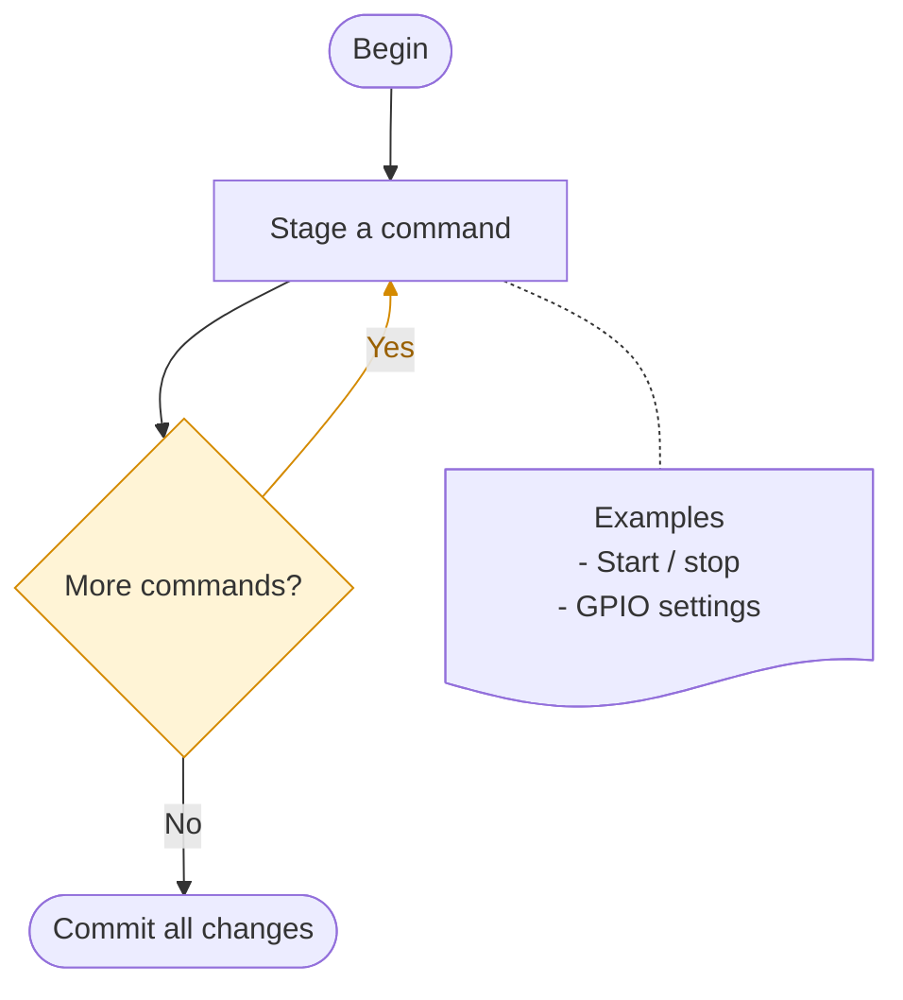

# Flowchart Agent Kit

Build: `{{KIT_VERSION}}`

Use `flowchart-convert.mjs` for process diagrams. `flowchart.schema.json` is the standalone
JSON Schema Draft 2020-12; it has no dependency on the Blockchart Schema. The validator
also checks references, groups, notes and styles. JSON export preserves authoring data,
not coordinates or layout records. Mermaid input is compiled to the same Flowchart JSON.

## Agent workflow

1. Identify process steps, decisions, start/end points, condition labels and notes.
2. Write supported Mermaid text, or write Flowchart JSON against its Schema.
3. Run `--check`; fix syntax and semantic errors before rendering.
4. Export SVG and inspect the result and any label-clearance warnings.
5. Deliver Mermaid and/or JSON with SVG. The source project can additionally export PNG.

```sh
node flowchart-convert.mjs process.mmd --check --diagnostics json
node flowchart-convert.mjs process.mmd --output process.json
node flowchart-convert.mjs process.json --output process.svg
node flowchart-convert.mjs - --input-format mermaid --output - --format svg
node flowchart-convert.mjs - --input-format json --output - --format json
```

`.json` input is parsed as JSON; other extensions default to Mermaid. Override with
`--input-format json|mermaid`; stdin defaults to Mermaid. Output format is inferred from
`.json` or `.svg`, or specified with `--format`. Stdout requires `--format`. `--check` does
not lay out or write files. Output is staged and replaced only after conversion succeeds;
input cannot be overwritten. Text checks print an OK message; JSON diagnostics go to
stderr. Errors include a stage and, where applicable, path or source line/column.
Exit codes: 0 success, 1 parse/validation/layout/I/O failure, 2 invalid arguments.
Warnings do not fail conversion. No PNG, group-scoped export or image recognition is
included in the standalone Flowchart converter.

## Supported Mermaid subset



Supported syntax:

- `flowchart` / `graph`, with TD/TB, LR, RL or BT.
- ASCII IDs: letter/underscore first, followed by letters, digits or underscore.
- `A["Process"]`, `A{"Decision"}`, `A(["Terminator"])`, `A("Terminator")`, and bare IDs.
- Expanded shapes: `rect`/`rectangle`, `diam`/`diamond`/`decision`, `stadium`/`rounded`,
  and `doc`/`document`. Document nodes render as folded notes attached to a process node.
- Quoted plain-text labels, JSON escapes (`\n`, `\\`), and `<br/>` line breaks.
  Other HTML is escaped as text; Markdown labels are unsupported.
- `-->`, `---`, `-.->`, `-.-`, `==>`, chains, `-->|condition|`, and `-- condition -->`.
- Nested `subgraph ID["Title"]` ... `end`; edges attach to nodes, not groups.
- `classDef`, `class A,B name`, `:::name`, `style ID ...`, and zero-based
  `linkStyle 0,1 ...` / `linkStyle default ...` (indices include associations).
- Styles: `fill`, `stroke`, `color`, `stroke-width`, `font-size`, `opacity`.
  Colors are hex or `transparent`; font/width numbers accept optional `px`.
- Semicolons, CRLF and standalone `%%` comments.

Unsupported constructs are errors: init/frontmatter configuration, callbacks, images,
arbitrary CSS, circle shapes, `&` fan-out shorthand, custom edge IDs, and subgraph-specific
direction. Do not assume full Mermaid compatibility.

## Flowchart JSON

```json
{
  "version": 1,
  "diagram": { "name": "Batch update" },
  "layout": { "direction": "down", "loopSide": "right" },
  "nodes": [
    { "id": "Start", "type": "terminator", "label": "Begin" },
    { "id": "Work", "label": "Stage a command" },
    { "id": "More", "type": "decision", "label": "More commands?" },
    { "id": "Done", "type": "terminator", "label": "Commit" },
    { "id": "Help", "type": "note", "label": "Staged writes", "attachTo": "Work", "side": "right" }
  ],
  "edges": [
    { "from": "Start", "to": "Work" },
    { "from": "Work", "to": "More" },
    { "from": "More", "to": "Done", "label": "No" },
    { "from": "More", "to": "Work", "kind": "loop", "label": "Yes" },
    { "from": "Work", "to": "Help", "kind": "association" }
  ]
}
```

Required: `version:1`, `diagram.name`, nonempty `nodes`, and `edges`. Optional `groups`
are flat objects with `id`, optional `label` and `style`, and nonempty unique `members`.
Nodes/groups share unique IDs and a member can have only one parent; cycles are rejected.
JSON IDs allow letters/underscore first, then letters, digits, underscore or hyphen.
Do not put `$schema`, coordinates, normalized models, or layout results in input JSON.

Node fields: `id`, `label` (default ID), `type` (process/decision/terminator/start/end/note),
positive logical `width`/`height` minima, and `style`. Notes additionally have `attachTo`
and left/right/top/bottom `side`. A note can infer its attachment from an association to
a non-note node. One note per owner is supported; note and owner must belong to the same
group. Notes reserve space beside their owner without introducing a flow level.

Edge fields: optional unique `id`, `from`, `to`, optional `label`, `kind` (flow/loop/association),
boolean `arrow`, `fromSide`/`toSide`, and `style`. IDs default deterministically. Back edges
are inferred as loops in the normalized model; explicit `kind:"loop"` clarifies intent.
Associations default to dotted and arrowless. Separate outgoing edges have separate
condition labels. Flowchart has no hardware Ports, bit widths, Nets or Concat nodes.

Layout: `direction` down/right/up/left, positive `nodeSpacing` (40), `layerSpacing` (60),
`noteGap` (40), and `loopSide` auto/left/right/top/bottom. Loop side must be perpendicular
to flow; auto uses right for vertical flow or bottom for horizontal flow. Notes default to
right for vertical flow or bottom for horizontal flow. Use larger spacing, shorter labels
or explicit sides if rendering reports `FLOW_LABEL_OVERLAP`.

Node/group styles: `fillColor`, `borderColor`, positive `borderWidth`, `borderStyle`,
non-negative `borderRadius`, `color`, positive `fontSize`, non-negative `padding`, `opacity`.
Edge styles: `strokeColor`, positive `strokeWidth`, `lineStyle`, `color`, positive `fontSize`,
`labelBackgroundColor`, `opacity`. Colors accept hex or `transparent`; patterns are
solid/dashed/dotted; opacity is in [0,1]. Global defaults are under
`diagram.style.node`, `.edge`, `.group`, `.note`; per-object styles override properties.
`diagram.caption` adds text below the chart. Text uses portable monospace measurements.

## Importable API

```javascript
import { parseMermaid, validateFlowchart, convertFlowchart, KIT_VERSION } from './flowchart-convert.mjs';

const text = 'flowchart TD\nA["Start"] --> B["Finish"]';
const document = parseMermaid(text);
validateFlowchart(document); // { ok: true }
const json = await convertFlowchart(text, { format: 'json' });
const svg = await convertFlowchart(document, { format: 'svg' });
console.log(svg.text);
```

Strings default to Mermaid; objects default to JSON. For a JSON string, pass
`{inputFormat:"json"}`. `convertFlowchart` returns `{format,text,warnings}` and supports
only JSON/SVG. Input objects remain unchanged. Errors include `stage`, and syntax errors
include `line` / `column`. Importing the module does not run the CLI or write files.
